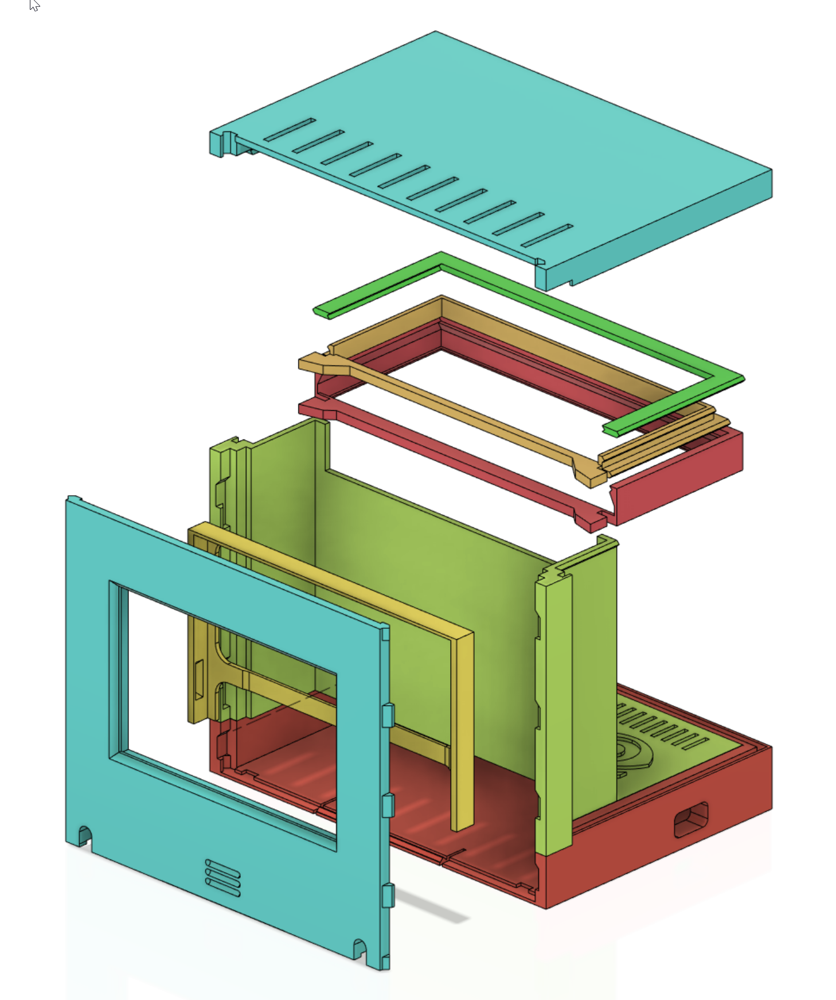

## 3D model
An enclosure (3D model) of the IBM Q System One can be used for RasQberry. STL files are available at [https://github.com/JanLahmann/RasQberry_enclosure](https://github.com/JanLahmann/RasQberry_enclosure) ([original source]( https://github.com/BAndiT1983/RasQberry_enclosure)). This is based on an idea of Andy Stanford-Clark [https://github.com/andysc/IBM-Q-System-One-3D-model](https://github.com/andysc/IBM-Q-System-One-3D-model). Additional instructions for assembling the enclosure and all components (Raspberry Pi, 4'' touchscreen display, battery pack inside the enclosure, etc.) will be provided later.

  

### Assembly for Version 5.5
 

[Go back to: Content](./README.md)  
[Go back to: Start Page](../README.md) 
