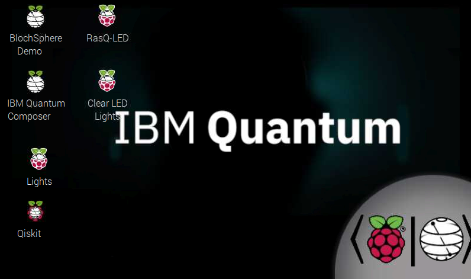
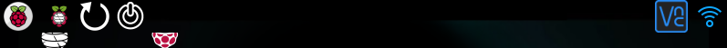
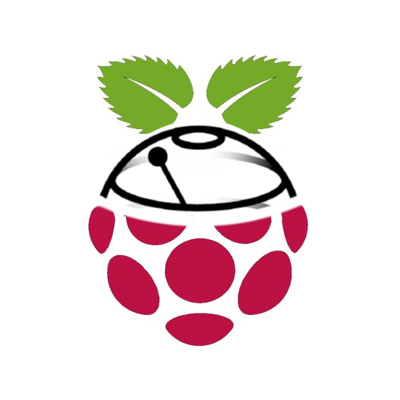

# How to use your RasQberry
In this document you can find information on how to use your RasQberry

## Start your RasQberry
On the opposite site of your touch display you can see a hole, which is big enough to insert your stilo pen. By inserting th pen and pressing the button **once** you turn on the battery. 
On the right side from the touch display you can see a bigger hole. This is big enough for a USB-C Charger to recharge the battery if necessary.
 

  
  

 

 

  
  

 

## Shutdown and turn of your RasQberry
First close all open windows. 
Next you need to shutdown your RasQberry pi. 
The last thing is to turn off the battery. In the hole on the opposite site if the display, insert your stilo pen and press the button **twice**. The battery is now turned off.

 

## Overview Desktop
With your stylo pen you can tip onto the very top of your touch display (first pixel-row) or if you have a mouse connected you can move it to top of your screen. 
The taskbar appears.
  

  
  

 

On the left side you can see the *applications' menu,* the *RasQerry Configuration Tool*, the *reboot* button and the *shutdown* button. 
On the right side you can see the *VNC Viewer* and the *Wi-Fi*. 
You can find the virtual keyboard in the application menu under *Accessories*.
 
 

## The Desktop Icons
When you installed RasQberry on your Raspberry Pi then there should be an icon on your desktop.

### Kivy Interface
  
When you click this icon you open the kivy user interface in which you can navigate through the demos and serious games.

## The Applications Menu
In the Applications Menu you can find all RasQberry Demos. 
Under **Demos** you'll find the Demos that you can use with your touch display and the LED Lights. 
Under **HD Demos** you'll find the Demos we would recommend using a larger screen or the second VNC Screen. 

[Go back to: Content](./README.md)  
[Go back to: Start Page](../README.md) 
